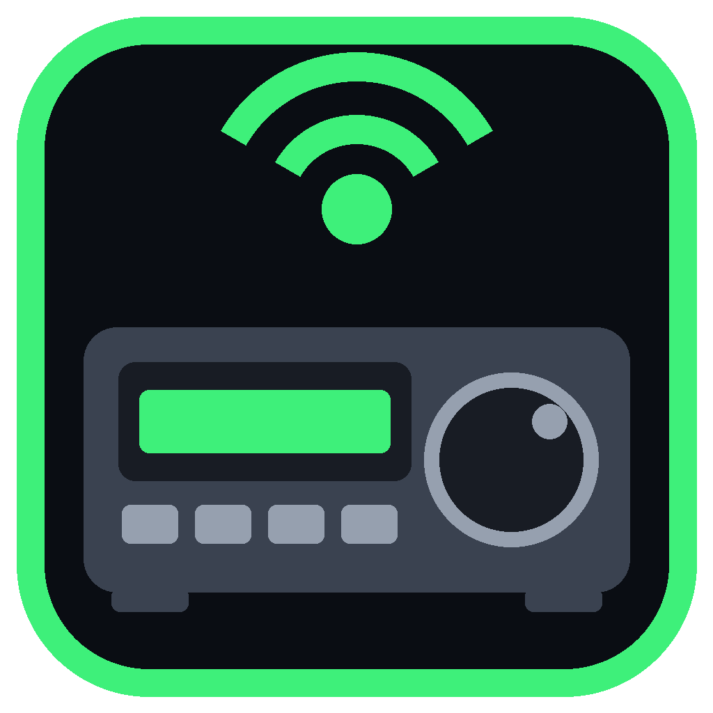
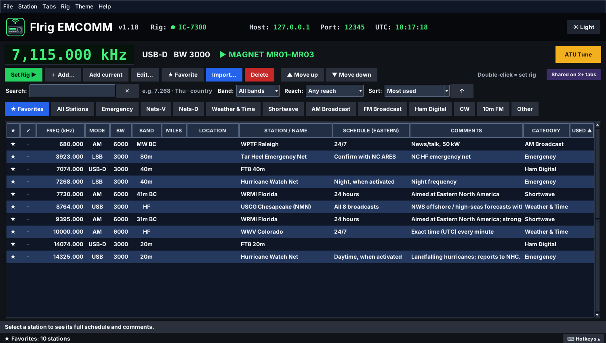
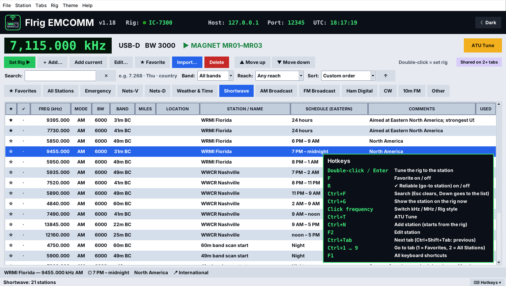

<p align="center"></p>

<h1 align="center">Flrig EMCOMM</h1>

<p align="center">An organized station list that tunes your radio.<br>
Double-click a station and <a href="http://www.w1hkj.org/">flrig</a> sets the frequency, mode and filter.</p>

<p align="center"><b><a href="../../releases/latest">⬇ Download for Windows or Linux</a></b></p>



## What it does

- **One click to the station.** Double-click (or press Enter) and the rig goes there: frequency, mode and filter. A single click only highlights.
- **Tabs for everything you listen to:** Favorites, Nets (voice and digital), Emergency, Weather & Time, Shortwave, AM and FM broadcast, Ham Digital, CW, 10m FM. Add your own tabs and drag them into order.
- **Starter list included:** WWV, VOLMET, USCG weather, Hurricane Watch Net, MAGNET, AmRRON, GhostNet, FT8/FT4/JS8/WSPR and more.
- **★ Favorites and ✔ Reliable marks** so the stations that usually come in are always at the top.
- **Find things fast:** search anything (name, 7.268 or 7268, mode, band, town, schedule), filter by band or by distance from home, sort by any column or by most used.
- **Build lists with any AI.** The Import tool writes a ready-made request for ChatGPT, Claude, Copilot and others, then reads the reply, flags duplicates and lets you review before anything is added. CSV files work too.
- **Live rig readout** with UTC clock, **ATU Tune** button, and kHz / MHz / rig-style frequency display.
- **Light and dark themes**, adjustable text size, works on two monitors, full keyboard shortcuts (press **F1**).



## Install

You need **flrig** set up and talking to your radio. Its XML-RPC server (port 12345) is on by default.

| | Download | Steps |
| --- | --- | --- |
| **Windows 10/11** | `FlrigEMCOMM_Setup_1.19.exe` | Double-click and follow the steps (click **Yes** at the administrator prompt; it installs in Program Files). If Windows says *"Windows protected your PC"*, click **More info > Run anyway**. Prefer no installer? Download `FlrigEMCOMM.exe`, put it in its own folder and double-click. |
| **Linux** (Mint 21+, Ubuntu 22.04+, most others) | `FlrigEMCOMM_Ver_1.19_Linux.tar.gz` | Save it in Downloads, open a terminal and paste the three lines from [Installing on Linux](docs/Installing_Flrig_EMCOMM_on_Linux.pdf). It unpacks into *~/Applications/Flrig EMCOMM Ver 1.19*, adds the menu entry and desktop icon, and starts the app. Updates: the same three lines with the new file. Or use `FlrigEMCOMM-x86_64.AppImage`: make it executable and double-click. From the source code: `bash linux_install.sh`. |

Nothing else to install. On first start the app asks where you are (grid square is fine) and puts an icon on your desktop. Your stations are saved in `flrig_stations.json`, in `%APPDATA%\Flrig EMCOMM` on Windows and `~/.local/share/flrig-emcomm` on Linux, never in the program folder. Copy that file to back up or move your list.

Printable guides (PDF): [Windows install](docs/Installing_Flrig_EMCOMM_on_Windows.pdf) · [Linux install](docs/Installing_Flrig_EMCOMM_on_Linux.pdf) · [User guide](docs/Flrig_EMCOMM_User_Guide.pdf) · [Features](docs/Flrig_EMCOMM_Features.pdf)

### Run from the source code

Needs Python 3.8 or newer with Tk (Windows: the python.org installer; Linux: `sudo apt install python3-tk`).

```
git clone https://github.com/HamRadioMadeSimple/Flrig-EMCOMM.git
cd Flrig-EMCOMM
python3 run.py
```

## Tested with

Icom IC-7300 through flrig 2.0 on Windows 11 and Linux Mint 22. Any radio flrig supports should work; reports from other rigs are welcome.

## Help and feedback

Open an [issue](../../issues) with a screenshot and, if something went wrong, the file `flrig_emcomm.log` from the same folder as your station list (`%APPDATA%\Flrig EMCOMM` on Windows, `~/.local/share/flrig-emcomm` on Linux).

Want to help with the code? See [CONTRIBUTING.md](CONTRIBUTING.md).

## License

Copyright © 2026 KW3KW. Free software under the [GNU General Public License v3.0 or later](LICENSE), the same license as flrig and fldigi.

Flrig EMCOMM is an independent project and is not part of flrig. Credits for the parts that are not ours: [NOTICE.md](NOTICE.md).
